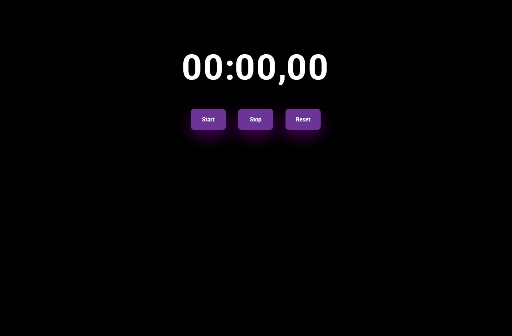

<h1 align="center">⏱️ Cronômetro</h1>

  

  <b><a href="https://jonataswebj-lab.github.io/Cronometro/">🔗 Ver site no ar</a></b>

Cronômetro digital com minutos, segundos e centésimos de segundo.

## O que o projeto faz
- **Start** inicia a contagem
- **Stop** pausa, e o botão passa a mostrar "Resume" para continuar de onde parou
- **Reset** zera o cronômetro
- Impede que dois cliques seguidos em "Start" criem duas contagens ao mesmo tempo

## Tecnologias

## O que pratiquei
- `setInterval` e `clearInterval`
- Controle de estado com variáveis
- Cálculo de minutos, segundos e centésimos com `Math.floor` e o operador `%`
- Formatação com `padStart`
- Layout responsivo com Flexbox e `@media`

## Próximos passos
- [ ] Medir o tempo real com `Date.now()` pra o cronômetro não atrasar
- [ ] Adicionar registro de voltas
- [ ] Usar `addEventListener` no lugar do `onclick` no HTML

## Como rodar
Baixe o repositório e abra o `index.html` no navegador.
